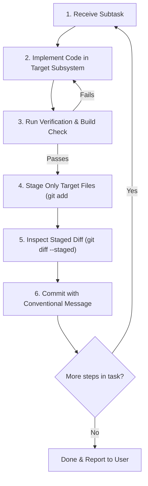

# GEMINI.md — Agent System Instructions & Workflow Controls

> **Target Audience**: AI Agents (Gemini, Antigravity, Cursor, Claude Code, GitHub Copilot)  
> **Repository**: SmartWorkstation-Embeded_System (Chulalongkorn CEDT 2110356)  
> **Reference Guide**: Read `AGENTS.md` for pinouts, MQTT payloads, and subsystem architectures.

---

## 1. Core Operating Principles

1. **Step-by-Step Execution**: Never execute huge multi-module overhauls in a single sweep. Break tasks into distinct, logical steps:
   $$\text{Plan} \longrightarrow \text{Implement} \longrightarrow \text{Build / Verify} \longrightarrow \text{Commit}$$
2. **Atomic Commits (Commit Each Step)**: Commit immediately after finishing and verifying each coherent step. Do not batch unrelated tasks together.
3. **Verify Before Committing**: Every commit MUST pass local compilation or syntax verification before being committed.
4. **Zero-Secret Policy**: Never commit real credentials, passwords, Wi-Fi keys, webhook URLs, or tokens. Ensure `.env` is ignored and only `.env.example` is tracked.

---

## 2. Git Commit Standards (Strict Conventional Commits)

All commits in this repository must strictly adhere to the Conventional Commits specification:

```text
<type>(<scope>): <short imperative summary>

[optional body explaining context and reasoning]
```

### 2.1 Allowed Types
- `feat`: A new feature or subsystem implementation (e.g., FreeRTOS task, hardware driver, AI classification).
- `fix`: A bug fix (e.g., race condition in queue, sensor calculation overflow, wrong pin assignment).
- `docs`: Documentation updates (e.g., `README.md`, `AGENTS.md`, code comments, architecture diagrams).
- `refactor`: Code refactoring that neither adds a feature nor fixes a bug.
- `perf`: Code changes that improve runtime performance, reduce CPU cycles, or save power.
- `test`: Adding or updating test cases (e.g., mock hardware simulations, quantitative latency tests).
- `chore`: Build tooling, PlatformIO library updates, dependencies, formatting.

### 2.2 Scopes
Use one of the following lowercase scopes (or omit scope if change is global):
- `node1`: Chair sensor node (`SensorNodes/Node1/`)
- `node2`: Desk environment sensor node (`SensorNodes/Node2/`)
- `gateway`: Raspberry Pi central daemon (`Gateway/`)
- `interface`: React web dashboard (`Interface/`)
- `ai`: Scikit-learn model, inference pipeline, or training scripts
- `hardware`: GPIO, PWM, I2C, or actuator drivers
- `deps`: Dependency updates (`requirements.txt`, `package.json`, `platformio.ini`)

### 2.3 Commit Message Rules
- Use the **imperative mood** in the summary line ("add", "implement", "fix", "refactor" — NOT "added", "fixing", "implements").
- Keep the summary line under **72 characters**.
- Do not capitalize the first letter after the colon (e.g., `feat(node1): implement FreeRTOS seat task`, NOT `feat(node1): Implement...`).
- No period (`.`) at the end of the summary line.
- Provide bullet points in the commit body for multi-part changes.

### 2.4 Concrete Commit Examples
- `feat(node1): add FreeRTOS seat sampling task with debouncing`
- `feat(node1): implement ext0 deep sleep wake-up on GPIO 33`
- `feat(node2): implement 50ms windowed ADC sampling for MAX9814`
- `fix(gateway): resolve deadlock in thread-safe state lock`
- `refactor(hardware): separate mock peripheral simulation from RPi GPIO`
- `feat(interface): integrate real-time MQTT WebSocket telemetry feed`
- `docs: update AGENTS.md with exact ESP32 pin assignments`

---

## 3. Step-by-Step Commit Workflow for Agents

When assigned a task, follow this exact cycle for **each sub-step**:



### Pre-Commit Verification Commands:

#### For `SensorNodes/Node1` or `SensorNodes/Node2`:
```bash
cd SensorNodes/<NodeDir>
pio run
```
*Never commit firmware changes if `pio run` throws compilation errors.*

#### For `Gateway/`:
```bash
cd Gateway
python -m py_compile gateway_main.py hardware_interface.py train_ai_model.py
python gateway_main.py --mock --test-run # if supported, or quick mock syntax check
```
*Ensure Python files have valid syntax and import resolution.*

#### For `Interface/`:
```bash
cd Interface
npm run build
```
*Ensure JSX/Vite compiles cleanly without missing imports.*

---

## 4. Strict Rubric Constraints (2110356 Embedded System)

When writing code, you must never violate these project constraints:

1. **Sensors (M1)**: Buttons and switches are **NOT** environmental sensors. Do not count limit switches or seat switches toward the 5 sensor types. True sensors are: Ultrasonic, BH1750 Lux, FSR Pressure, DHT22 Temperature, MAX9814 Sound.
2. **Actuators (M2)**: LEDs and buzzers are **NOT** actuators. Actuators are physical motion devices: 28BYJ-48 Stepper Motor and SG90 Servo Motor.
3. **AI Logic (M4)**: Fixed thresholds or if-else ladders do **NOT** count as AI. Closed-loop control must be driven by the trained `RandomForestClassifier` pipeline (`model.joblib`).
4. **Depth Items (E1–E5)**:
   - **E1**: Must use FreeRTOS queues/semaphores with at least 3 distinct tasks and reasoned priorities.
   - **E2**: Hardware inputs must use ISR (`attachInterruptArg` / `gpio_isr_handler_add`) with deferred queue handling. **No busy polling in `loop()`**.
   - **E3**: Must implement low-power sleep modes and provide battery life projections.
   - **E4**: Must implement packet sequence counters, ACK/retries, and store-and-forward offline buffers.
   - **E5**: TLS encryption and `.env` credentials only.
5. **E7 Caveat**: Raspberry Pi does **not** qualify for E7 (On-Device AI on MCU). Do not reassign E7; stick to E1–E5 for the 10/10 depth points.

---

## 5. Clean Repository Etiquette

- Never stage untracked scratch files, `.pio/`, `.venv/`, `.vscode/` user caches, or `node_modules/`.
- Never stage or commit `proj_details/` (it is git-ignored for local project notes and large PDFs).
- Stage specifically by file path (`git add <file>`), avoiding indiscriminate `git add .` whenever possible.
